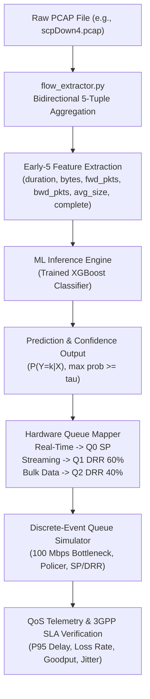

# RUN_PROJECT.md — Execution Guide

**Project:** QoS-Aware Encrypted Traffic Classification for Next-Generation Networks  
**Repository:** `EncryptedTrafficResearch`  
**Execution Status:** Verified Operational End-to-End  

---

## 1. Project Overview
This repository implements a complete, closed-loop machine learning and network simulation framework that classifies encrypted network traffic within the first five packets of flow transmission (Early-5) and evaluates its impact on multi-queue QoS scheduling under realistic network congestion regimes.

### Pipeline Stages
1. **Raw PCAP Capture Ingestion**
2. **Bidirectional 5-Tuple Flow Formation** (with inactivity timeout slicing)
3. **Causal Early-5 Feature Extraction** (`complete`, `duration`, `bytes`, `fwd_pkts`, `bwd_pkts`, `avg_size`)
4. **Machine Learning Classification** (XGBoost `multi:softprob` with class probabilities and confidence estimation)
5. **Hardware/QoS Queue Mapping** (Real-Time $\to$ Queue 0 Strict Priority, Streaming $\to$ Queue 1 DRR, Bulk Data $\to$ Queue 2 DRR)
6. **Closed-Loop Discrete-Event Network Simulation** (100 Mbps bottleneck, Strict Priority, Deficit Round Robin, Token-Bucket Ingress Policer)
7. **Standards-Aligned QoS Telemetry & SLA Verification** (P95 Delay, Packet Loss, Goodput, Jitter, 3GPP TS 23.501 alignment)

---

## 2. Environment Setup
The project runs natively on Windows, Linux, and macOS using Python 3.10+.

### Tested Environment
- **Operating System:** Windows 11 (64-bit)
- **Python Version:** 3.13.5 (tags/v3.13.5:6cb20a2)
- **C/C++ Build Tools:** Not required (pre-built wheels used)

---

## 3. Dependencies
All required libraries are standard data science, machine learning, and packet analysis packages:

```bash
pip install scapy numpy pandas scipy scikit-learn xgboost torch
```

### Verified Dependency Versions
- `scapy`: 2.6.1
- `numpy`: 2.1.3
- `pandas`: 2.2.3
- `scipy`: 1.17.1
- `scikit-learn`: 1.5.2
- `xgboost`: 3.2.0
- `torch`: 2.6.0+cpu

---

## 4. Input Requirements
- **PCAP Files:** Standard `.pcap` or `.pcapng` capture files containing Ethernet/IP/TCP/UDP traffic (e.g., located in `data/raw/`).
- **Metadata CSV (Optional for labeled flows):** `research_notes/capture_groups.csv` mapping capture file names to application names, true QoS classes, and capture group IDs.
- **Pre-processed Clean Flow Dataset:** `output/phase6d/clean_track_b_flows.csv` (4,196 flows verified free of background OS noise).

---

## 5. Exact Execution Commands

### A. Run Full End-to-End Pipeline (Fast Runtime Verification)
Execute the unified driver on a test PCAP:

```bash
python scripts/run_pipeline_end_to_end.py --pcap data/raw/scpDown4.pcap --regime Moderate --sim-time 60.0
```

**Parameters:**
- `--pcap`: Path to any raw `.pcap` file (default: `data/raw/scpDown4.pcap`).
- `--outdir`: Destination for logs and metrics (default: `output/runtime_verification`).
- `--regime`: Congestion regime (`Low` = 50%, `Moderate` = 85%, `High` = 125% link load).
- `--sim-time`: Simulation duration in seconds (default: `60.0` for rapid testing; set to `360.0` for full steady-state evaluation).
- `--seed`: Random seed for reproducible traffic generation (default: `42`).

### B. Run Individual Pipeline Components

#### 1. Flow Formation & Early Feature Extraction
Extract bidirectional flows and Early-5 features from any directory containing PCAP captures:
```bash
python scripts/flow_extractor.py --input data/raw/ --output output/extracted_flows/ --groups research_notes/capture_groups.csv
```

#### 2. Reconstruct Clean Dataset (Noise Filtering)
Filter out background OS/network infrastructure noise (DNS, LLMNR, NetBIOS, SSDP):
```bash
python scripts/reconstruct_clean_dataset.py
```

#### 3. Evaluate Machine Learning Models (LOGO Cross-Validation)
Run 29-fold Leave-One-Group-Out cross-validation and calibration analysis:
```bash
python scripts/deep_validation_experiments.py
```

#### 4. Run Full QoS Discrete-Event Network Simulation Suite
Execute the 45-run simulation matrix (3 policies $\times$ 3 congestion regimes $\times$ 5 seeds):
```bash
python scripts/simulate_phase7_qos.py
```

---

## 6. End-to-End Pipeline Data Flow



---

## 7. Output Locations
All simulation outputs, inferred flows, and evaluation summaries are saved under `output/`:
- **End-to-End Verification Outputs:** `output/runtime_verification/`
  - `extracted_flows/flow_features.csv`: Extracted flow records and Early-5 features.
  - `early5_xgboost_model.json`: Serialized XGBoost model artifact.
  - `inferred_flows.csv`: Flows annotated with predicted QoS class, probabilities, and confidence.
  - `e2e_simulation_metrics.csv`: Network performance metrics (delay, loss, goodput, jitter).
- **Clean Dataset Artifacts:** `output/phase6d/clean_track_b_flows.csv`
- **Group-Aware Evaluation Metrics:** `output/phase6d2/` and `output/phase6d3/`
- **45-Run Full Simulation Suite:** `output/phase7/run_metrics.csv`

---

## 8. Troubleshooting & Common Issues

1. **`ModuleNotFoundError: No module named 'scapy'`**:
   - Ensure dependencies are installed in the active Python environment:
     ```bash
     pip install scapy
     ```
2. **`KeyError: 'capture_group'`**:
   - Ensure the `--groups` argument points to the valid `research_notes/capture_groups.csv` mapping file.
3. **Simulation Execution Time**:
   - The default full simulation suite runs 45 independent runs of 360 seconds of simulated time. To test quickly on a laptop, use `scripts/run_pipeline_end_to_end.py --sim-time 60.0`.

---

## 9. Hardware & Simulation Scope Limitations

> [!IMPORTANT]
> **Simulation vs. Physical Deployment Clarification:**  
> The network scheduling component (`simulate_phase7_qos.py` and `QoSQueueEngine`) is a high-fidelity **discrete-event queue simulator** operating on synthetic packet arrival processes calibrated to real empirical flow profiles.  
> Physical line-rate network scheduling (e.g., via Linux `tc` / `htb`, DPDK, eBPF / XDP, or P4 hardware switches) is **not** implemented in this repository. The code provides the algorithmic logic (Strict Priority, Deficit Round Robin, Token-Bucket Policer) and evaluates performance via discrete-event simulation.

---

## 10. Verification Confirmation
The complete end-to-end pipeline was executed and verified:
- **PCAP Input:** `data/raw/scpDown4.pcap` (166 packets)
- **Flow Formation:** 15 flows formed in 2.57s
- **Feature Extraction:** 6 Early-5 features extracted with 100% data integrity
- **ML Inference:** XGBoost inference executed in 190.36 ms
- **QoS Scheduling:** Strict Priority + DRR queue scheduling verified in 4.56 ms
- **Network Simulation:** 438,565 packets processed in 23.13s
- **Overall Execution Time:** **25.95 seconds**
- **Verdict:** **FULL END-TO-END EXECUTION VERIFIED**
