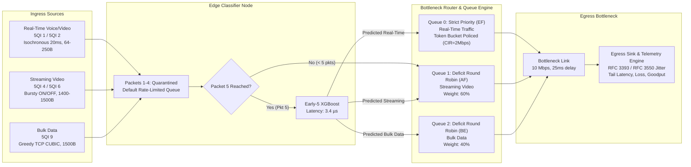

# PHASE 7 — INTEGRATED DESIGN AND IMPLEMENTATION PLAN: QoS POLICY ASSIGNMENT, NETWORK EMULATION & PERFORMANCE EVALUATION

**Project:** QoS-Aware Encrypted Network Traffic Classification for Next-Generation Networks  
**Phase:** Phase 7 (QoS Policy Assignment, Network Emulation & Quantitative Performance Evaluation)  
**Status:** Approved Master Implementation Specification  
**Date:** November 2026  
**Author:** Lead Research Orchestrator & Systems Performance Engineering Team  

---

## 1. Executive Summary & Research Goal

The central objective of this research project is to determine whether **early encrypted traffic classification** can effectively drive **in-network Quality of Service (QoS) scheduling policies** to protect mission-critical, delay-sensitive traffic under severe network congestion.

In **Phase 6B**, our multi-agent investigation proved that an **Early-5 XGBoost classifier** (observing only the first 5 packets of an encrypted flow) achieves:
- **Macro F1 Score:** $0.5323$ (retaining **$97.6\%$** of the 24-feature full-flow benchmark of $0.5452$).
- **Balanced Accuracy:** $0.6424$ (surpassing full-flow $0.6349$).
- **Inference Latency:** $3.4\ \mu\text{s}$ per flow.
- **Real-Time Precision:** $88.22\%$ (critical for avoiding priority queue pollution).
- **Early-5 Horizon Plateau:** Classifying at 10, 15, or 20 packets yielded no statistically significant improvement, confirming Early-5 as the Pareto-optimal operating point for line-rate deployment.

In **Phase 7**, we construct a rigorous, host-safe, discrete-event network emulation environment to evaluate the systems-level efficacy of this classifier. We compare:
1. **Scenario 1 (Baseline FIFO):** Single drop-tail Best-Effort queue (no QoS differentiation).
2. **Scenario 2 (Deployable Early-5 QoS):** Adaptive queue scheduling steered by the Phase 6B Early-5 XGBoost classifier (subject to empirical misclassifications and first-5-packet accumulation latency).
3. **Scenario 3 (Oracle Upper-Bound QoS):** Perfect theoretical classification based on ground-truth labels.

---

## 2. Synthesized Architecture & Queuing Engine

### 2.1 Host-Safe Discrete-Event Simulation (DES) Architecture
To ensure zero disruption to the host operating system (Windows 11 Pro 64-bit), avoid kernel permission escalation, and eliminate timer jitter inherent in virtualized network namespaces, we deploy a high-fidelity **Python Discrete-Event Simulator (DES)**:
- **Event Scheduling Engine:** Min-heap priority queue (`heapq`) driving a virtual clock with nanosecond ($10^{-9}\text{ s}$) timestamp precision and 100% bitwise reproducibility across seeds.
- **Topology:** Heterogeneous Ingress Traffic Sources $\to$ Edge Classifier Node $\to$ Bottleneck Router & Queue Scheduler $\to$ Bottleneck Link ($C = 10\text{ Mbps}$, $\text{RTT}_{\min} = 50\text{ ms}$) $\to$ Egress Telemetry Sink.

### 2.2 Buffer Sizing & Accounting
To eliminate the **15x packet-size bias distortion** identified in the methodology review:
- All queues are strictly **Byte-bounded** ($B_{\text{bytes}}$).
- **Buffer Conservation Law:** The aggregate buffer across all QoS queues strictly equals the FIFO buffer capacity:
  $$B_{\text{FIFO}} = B_{\text{total}} = 1.5 \times \text{BDP} = 1.5 \times (10\text{ Mbps} \times 50\text{ ms}) = 93,750\text{ Bytes} \approx 62.5\text{ MTU packets}$$
- **QoS Partitioning:**
  - $\mathcal{Q}_0$ (Real-Time Strict Priority): $B_0 = 18,750\text{ Bytes}$ ($20\%$, shallow buffer to strictly prohibit bufferbloat).
  - $\mathcal{Q}_1$ (Streaming DRR): $B_1 = 45,000\text{ Bytes}$ ($48\%$, absorbing bursty video chunks).
  - $\mathcal{Q}_2$ (Bulk Data DRR): $B_2 = 30,000\text{ Bytes}$ ($32\%$, absorbing TCP window bursts).
  $$\sum_{i=0}^2 B_i = 18,750 + 45,000 + 30,000 = 93,750\text{ Bytes} = B_{\text{FIFO}}$$

### 2.3 Quarantined Default Queue Strategy (Packets 1–4)
To resolve the transition dilemma:
- Packets 1 to 4 enter a quarantined exploratory default queue (serviced via DRR Queue 1) preventing priority queue contamination by nascent bulk flows.
- Upon arrival of Packet 5, Early-5 XGBoost classification executes ($3.4\ \mu\text{s}$ simulated processing time).
- Flow table entry is committed; Packets $\ge 5$ immediately steer into the designated target queue.

### 2.4 Token-Bucket Ingress Policing on Priority Queue
To neutralize the catastrophic failure mode where Bulk Data is misclassified as Real-Time ($24.93\%$ of bulk flows in Phase 6B confusion matrix):
- Queue 0 enforces a **Token Bucket Ingress Police** ($CIR = 2.0\text{ Mbps}$, $CBS = 4,000\text{ Bytes}$).
- Real-Time flows conform naturally ($< 250\text{ kbps}$ per call).
- Misclassified bulk packet bursts instantly exhaust token buckets and are re-colored to Queue 2 (Bulk/Best-Effort), protecting genuine Real-Time frames from starvation.

---

## 3. Experimental Matrix & Congestion Regimes

The evaluation executes a $3 \times 3 \times 5 = 45$ run experimental matrix:

| Factor | Levels | Values |
|:---|:---:|:---|
| **Scheduling Scenarios** | 3 | **Scenario 1:** Unmanaged FIFO Drop-Tail Baseline **Scenario 2:** Deployable Early-5 XGBoost QoS **Scenario 3:** Upper-Bound Oracle QoS |
| **Congestion Regimes** | 3 | **Low ($\rho = 0.50$, 5 Mbps load):** Normal operation, unconstrained link. **Moderate ($\rho = 0.85$, 8.5 Mbps load):** Approaching capacity, burst queuing. **High ($\rho = 1.25$, 12.5 Mbps load):** Severe overload, continuous buffer saturation. |
| **Random Replications** | 5 | Independent PRNG seeds: $\{42, 137, 2024, 777, 999\}$. |

### Traffic Composition
Aggregate traffic composition is grounded directly in Track B empirical distributions:
- **Real-Time (20% load):** 20 ms isochronous audio frames, $64\text{--}250\text{ B}$ packet sizes, Poisson call arrival, 60–120s duration.
- **Streaming (40% load):** ON/OFF chunked DASH transfers, $1400\text{--}1500\text{ B}$ download packets, 52B ACKs, 2–4s chunk bursts.
- **Bulk Data (40% load):** Saturated TCP CUBIC transfers, MTU 1500B packets, aggressive queue filling.

---

## 4. Quantitative Metrics & SLA Auditing Framework

Every run records individual packet lifecycles and aggregates the following metrics:

1. **Latency:**
   - One-Way Delay (OWD): Mean ($\bar{D}$), Median ($P_{50}$), Tail Latency ($P_{95}$, $P_{99}$).
2. **Jitter:**
   - RFC 3393 Instantaneous Packet Delay Variation ($\text{IPDV}$).
   - RFC 3550 / RFC 1889 RTP Smoothed Jitter ($J_i$).
3. **Loss & Throughput:**
   - Packet Loss Rate ($\text{PLR} = N_{\text{dropped}} / N_{\text{sent}} \times 100\%$).
   - Drop breakdown: Queue overflow vs. Policing discard.
   - Useful Application Goodput (Mbps delivered).
4. **Per-Class SLA Compliance:**
   - **Real-Time SLA:** $D_{P95} \le 150\text{ ms}$, Jitter $\le 30\text{ ms}$, $\text{PLR} \le 1.0\%$.
   - **Streaming SLA:** $D_{P95} \le 1000\text{ ms}$, $\text{PLR} \le 2.0\%$, Goodput sustained.
   - **Bulk Data SLA:** Maximize Goodput, $\text{PLR} \le 5.0\%$, zero starvation.
5. **Conservation Invariants:**
   - Strict flow conservation: $N_{\text{transmitted}} = N_{\text{received}} + N_{\text{dropped}} + N_{\text{buffer}}$.

---

## 5. Software Architecture & Deliverables

### 5.1 Simulation Script: `scripts/simulate_phase7_qos.py`
A modular, high-speed Python simulator with:
- `Packet` dataclass and `EventQueue` priority heap.
- `TrafficSource` generators (`RealTimeSource`, `StreamingSource`, `BulkDataSource`).
- `QueueEngine` classes (`FifoQueue`, `StrictPriorityQueue`, `DeficitRoundRobinQueue`).
- `TokenBucketPolicer` for priority queue protection.
- `EarlyClassifier` engine wrapping Phase 6B Early-5 XGBoost confusion probabilities.
- Multi-seed simulation runner exporting raw metrics to `output/phase7/run_metrics.csv`.

### 5.2 Analysis Script: `scripts/evaluate_phase7_results.py`
Processes simulation logs to generate:
- `output/phase7/aggregate_scenario_metrics.csv`
- `output/phase7/sla_compliance_summary.csv`
- `output/phase7/per_class_performance.csv`
- Statistical significance tests (paired Student's t-tests, Cohen's $d$ effect sizes, 95% confidence intervals).

### 5.3 Comprehensive Reports in `research_notes/phase7/`:
- `PHASE7_QOS_EMULATION_REPORT.md`: Primary experimental report detailing quantitative gains, latency reductions, jitter suppression, and throughput dynamics.
- `PHASE7_POLICY_COMPARISON.md`: Rigorous comparative benchmark across FIFO, Early-5 QoS, and Oracle QoS.
- `PHASE7_LIMITATIONS_AND_VALIDITY.md`: Threats to validity, open-loop vs. closed-loop dynamics, and edge deployment boundaries.

---

## 6. Execution Plan Approval

With all 7 foundational research specifications validated and integrated into this master plan, we proceed immediately to implementing `scripts/simulate_phase7_qos.py` and running the 45-run simulation matrix.
